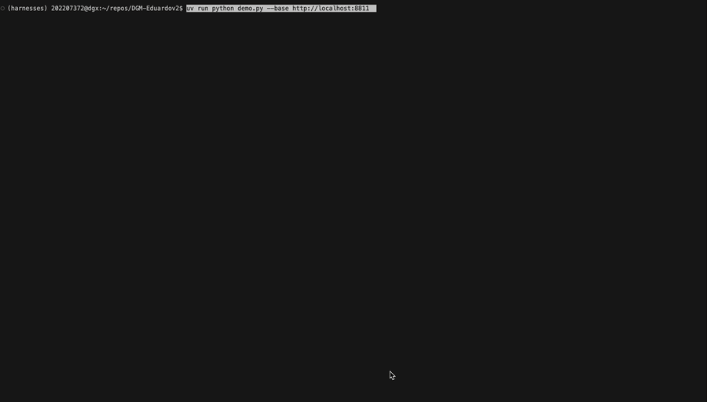
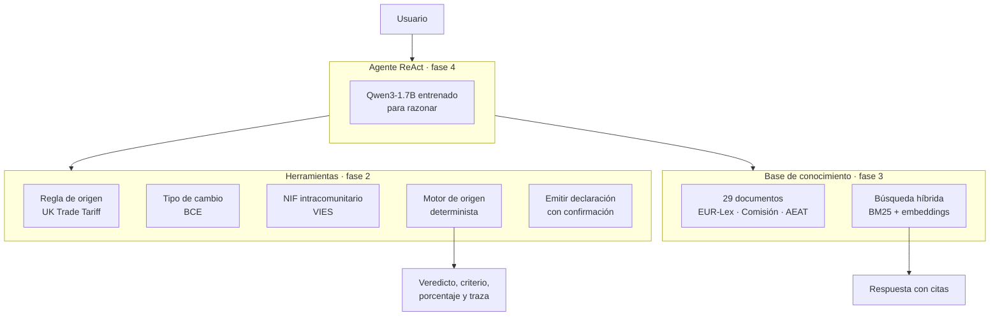

# ARCA — ¿es originario mi producto?
 
**Un asistente que dice a una pyme exportadora si su producto cumple las reglas de origen de un
acuerdo comercial de la UE, por qué criterio y con qué porcentaje.**
 
 
---
 
## El problema
 
La UE tiene acuerdos comerciales con Reino Unido, Japón, Corea, Canadá y otros países. Gracias a
ellos un producto europeo puede entrar con arancel reducido o cero, pero solo si se demuestra que
es **originario**: que está suficientemente fabricado en la UE y no es un producto de fuera con
una etiqueta nueva.
 
Cada producto tiene su regla, que depende de su código arancelario y del acuerdo. Hoy, el
responsable de comercio exterior de una pyme lo comprueba con una hoja de cálculo: lista de
materiales, código y origen de cada componente, declaraciones de proveedores y la regla leída en
un anexo legal. Tarda horas por producto y mercado.
 
Las consecuencias son dos, y las dos cuestan dinero:
 
- Muchas veces no compensa el esfuerzo y se paga el arancel general. Los exportadores españoles
  dejaron sin aprovechar **648 M€** de ahorro arancelario, más de 216 M€ solo en manufacturas.
- Si se equivoca, la aduana puede reclamar los derechos durante **tres años**.
## Qué hace ARCA
 
```
Usuario:  Exporto baterías de ion-litio a Reino Unido. Las vendo a 250 € en fábrica y llevan
          celdas chinas por 95 € y una placa de Taiwán por 20 €. ¿Son originarias?
 
ARCA:     Sí. No cumple el cambio de partida, porque las celdas chinas están en la misma
          partida que el producto (8507), pero sí el MaxNOM: los materiales no originarios
          suman 115 €, el 46,0 % del precio franco fábrica, por debajo del 50 % que fija la
          regla del TCA.
 
          ¿Quieres que te prepare la declaración de origen?
```
 
El veredicto nunca lo decide el modelo de lenguaje: lo calcula un motor de reglas determinista a
partir de la regla oficial, y el modelo se encarga de entender la pregunta, reunir los datos y
explicar el resultado.
 
## Demo
 

 
## Arquitectura
 

 
El cerebro sale de la **fase 1**: Qwen3-1.7B entrenado para razonar sobre reglas de origen, con
SFT por destilación y después GRPO con recompensas verificables.
 
## Resultados
 
Cada fase se mide contra la misma tarea **sin** la capacidad que añade, con problemas que el
modelo no ha visto.
 
| Fase | Qué mide | Sin la capacidad | Con ella |
|---|---|---|---|
| 1 · Razonamiento | Aciertos en 300 problemas de origen | 29,7 % | **67,3 %** |
| 2 · Herramientas | Respuestas correctas en 200 casos | 50,0 % | **88,7 %** |
| 3 · Conocimiento | Aciertos en 64 preguntas sobre normativa | 8 % | **81 %** |
| 4 · Agente | — | — | *pendiente* |
 
Algunos detalles que explican esos números:
 
- **Fase 1.** El modelo base ni siquiera entrega la respuesta en el formato pedido: solo el 19,7 %
  de sus salidas es válida. Tras el entrenamiento, el 91,3 %. La mejora del GRPO sobre el SFT
  (+8,7 puntos) es estadísticamente significativa.
- **Fase 2.** Ninguna configuración entrenada emitió una declaración de origen falsa ni se inventó
  una referencia. La clave fue quitarle al modelo la regla de las manos: desde que la herramienta
  la busca sola, las cadenas de llamadas pasaron del 50 % al 85 %.
- **Fase 3.** Sin el corpus, el modelo acierta **0 de las 58** preguntas que tienen respuesta: dice
  que no lo sabe en 46 y se inventa las 12 que contesta. Con la búsqueda híbrida acierta 48.
El detalle de cada medida, con sus fallos y lo que no funcionó, está en
[`EXPERIMENTS.md`](EXPERIMENTS.md).
 
## Cómo levantarlo
 
```bash
docker compose up api
```
 
La API queda en `http://localhost:8000/docs`, con un endpoint por fase:
 
| Endpoint | Qué hace |
|---|---|
| `GET /health` | Estado de cada fase |
| `POST /reasoning` | Resuelve un caso de origen razonando paso a paso |
| `POST /tools` | Responde usando las herramientas |
| `POST /rag` | Responde sobre normativa, con citas |
| `POST /agent` | El agente completo |
 
Ejemplo:
 
```bash
curl -s localhost:8000/rag -H 'content-type: application/json' \
  -d '{"question": "¿Cuánto tiempo es válida una declaración de origen en el acuerdo con Japón?"}'
```
 
Para desarrollo, sin Docker:
 
```bash
uv sync --extra train --extra rag
cp .env.example .env
uv run arca-api
```
 
Los pesos de los modelos y el corpus no están en el repositorio. Se descargan o se regeneran
siguiendo [`docs/fase1_reproducir.md`](docs/fase1_reproducir.md) y
[`docs/fase3_reproducir.md`](docs/fase3_reproducir.md).
 
## Cómo está construido
 
| Fase | Carpeta | Qué hay dentro |
|---|---|---|
| 1 · Razonamiento | [`rlm/`](rlm/README.md) | Generador de problemas verificables, motor de origen, destilación con Qwen3-4B, SFT con LoRA, GRPO con tres recompensas y un paso del algoritmo escrito a mano |
| 2 · Herramientas | [`tool_use/`](tool_use/README.md) | Cinco herramientas reales, el bucle de tool use escrito a mano, un banco de 31 casos y 2.400 trayectorias sintéticas para el SFT |
| 3 · Conocimiento | [`rag/`](rag/README.md) | Descarga reproducible del corpus, cuatro estrategias de troceado, BM25, embeddings e híbrido, y generación con citas verificadas |
| 4 · Agente | [`agent/`](agent/README.md) | El bucle ReAct, la memoria y el banco de tareas |
| — | [`api/`](api/README.md) | La API que expone las cuatro fases |
 
El dominio tiene una propiedad que lo hace ideal para esto: **la regla de origen es un algoritmo**,
así que un programa puede calcular la respuesta correcta de cualquier caso. Eso da un verificador
automático, y con él se puede entrenar por refuerzo y medir sin anotar nada a mano.
 
## Qué no hace
 
- **No sustituye a un asesor.** Quien firma la declaración de origen asume la responsabilidad ante
  la aduana. ARCA prepara el expediente y la traza; la decisión es de una persona.
- **Cubre cuatro acuerdos** (Reino Unido, Japón, Corea y Canadá) y las partidas que trae la API del
  UK Trade Tariff. No es exhaustivo.
- **El modelo todavía se equivoca leyendo.** Confundir Suiza con la UE, copiar mal un código o
  elegir mal la subdivisión de una regla siguen siendo sus fallos más frecuentes, y es la
  limitación de fondo que ninguna de las cuatro fases resuelve.
## Equipo
 
- Enrique Fernández-Baíllo Rodríguez de Tembleque
- Jacobo Banús Bertram
- Xabier Albizu Arias
## Licencia y fuentes
 
Los textos legales provienen de EUR-Lex y de la Comisión Europea (Decisión 2011/833/UE,
reutilización citando la fuente), de la AEAT (condiciones de reutilización propias) y del UK Trade
Tariff (Open Government Licence v3). Los modelos parten de Qwen3 (Apache 2.0).
